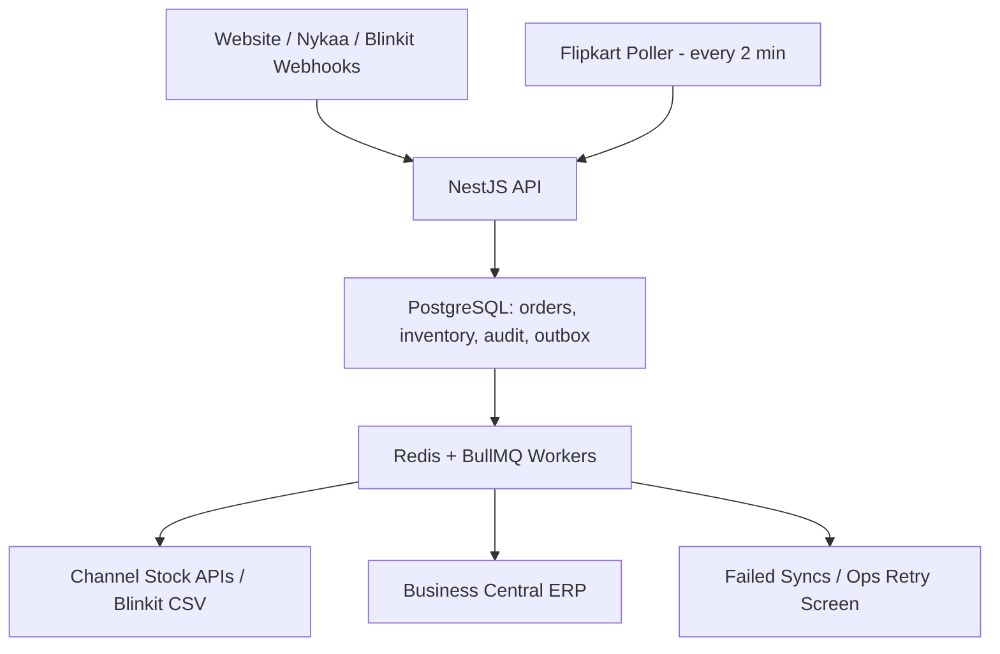

# MARS Cosmetics — Order & Inventory Sync Service

## The solution in 4 points

> **1. Centralized orders:** One **NestJS** service receives and normalizes orders from Website, Nykaa, Flipkart and Blinkit.
>
> **2. Safe inventory:** **PostgreSQL atomic transactions** reserve stock once per order and stop two orders from reserving the same last unit.
>
> **3. Fast stock updates:** **Redis + BullMQ** workers push stock changes to each channel, respecting its limits, and retry failures.
>
> **4. Reliable ERP sync:** A **transactional outbox** stores ERP delivery work with the order; workers retry after downtime, using an idempotency key to prevent duplicate ERP orders.

## 1. Architecture



**Deployment:** Run the NestJS API, poller and workers on AWS compute; PostgreSQL is the durable source of truth, and Redis backs job processing. Start with one modular application and separately scaled workers, not multiple microservices. Size the AWS setup against the ₹50,000/month cap before launch.

## 2. Data model

| Table | Main columns / constraints |
|---|---|
| `orders` | `id`, `channel`, `external_order_id`, `status`, `event_time`, `erp_status`; **UNIQUE(channel, external_order_id)** |
| `order_items` | `order_id`, `sku`, `qty`, `unit_price` |
| `inventory` | `sku` **PRIMARY KEY**, `on_hand`, `reserved`; `reserved >= 0`, `on_hand >= reserved` |
| `stock_movements` | `id`, `sku`, `order_id`, `delta_reserved`, `reason`, `created_at` (audit trail) |
| `outbox` | `id`, `event_type`, `entity_id`, `payload`, `status`, `attempts`, `next_retry_at`; unique event identity |
| `channel_sync` | `channel`, `sku`, `target_qty`, `last_synced_qty`, `status`, `error`, `updated_at`; **UNIQUE(channel, sku)** |

Available stock = `on_hand - reserved`. A single transaction creates the order, reserves each SKU, writes the stock movement and creates outbox events. Duplicate webhooks find the existing order instead of reserving again.

## 3. Order ingestion

- **Website, Nykaa, Blinkit:** Webhooks enter NestJS, are authenticated and normalized to one order format. Duplicate Nykaa events are ignored using the unique order key. Apply only valid status transitions; older events must not undo a newer state. Reconcile ambiguous event ordering against channel status when available.
- **Flipkart:** Poll every **2 minutes** (its fastest allowed interval), using a saved cursor/watermark and overlapping fetches with deduplication.
- If a channel is down, other channels continue. Retry failed polls and keep a visible backlog. A polling-only channel cannot provide instant order arrival.

## 4. Inventory consistency — the last unit

For an SKU with `on_hand = 1`, `reserved = 0`, two orders arrive simultaneously. Both try the following **inside a PostgreSQL transaction**:

```sql
UPDATE inventory
SET reserved = reserved + 1
WHERE sku = $1 AND on_hand - reserved >= 1
RETURNING sku;
```

Only one transaction can reserve the final unit. The other gets no returned row and is marked as insufficient stock; it must not be confirmed internally. For multi-item orders, lock/update SKUs in sorted order and roll back the entire transaction if any item fails. Cancellation releases a reservation **once**; returns increase sellable stock only after the warehouse confirms the returned unit is usable. Record every change in `stock_movements`.

**Important limitation:** Atomic database reservations stop *internal* overselling, but a marketplace may accept an order before its displayed stock updates. Use conservative channel buffers and prioritize zero-stock pushes; monitor the brief's **<=0.5% stock-related cancellation** target rather than promising absolute zero external oversells.

## 5. Stock push within 60 seconds

After each committed inventory change, an outbox event updates one latest-target record per `(channel, sku)`. BullMQ workers send the newest quantity rather than every intermediate change:

- **Website:** Direct owned API/DB update.
- **Nykaa:** One SKU/request; throttle to **5 requests/second**.
- **Flipkart:** Batch up to **50 SKUs/request**, max **10 requests/second**; back off on HTTP 429.
- **Blinkit:** Daily CSV baseline, urgent REST updates for changed/low-stock SKUs; retry timeouts carefully.

Track `stock_sync_lag_seconds` and alert when changes exceed **60 seconds under normal load**. During a sale, prioritize urgent zero-stock changes. If a channel's API cannot keep up, record and surface the delay instead of claiming an impossible guarantee.

## 6. Failure handling and ERP delivery

- **ERP downtime:** Commit the order and its `ERP_ORDER` outbox event together. Workers retry with exponential backoff through Sunday's **1–2 hour** outage; other channels remain operational.
- **Exactly once at ERP:** Send stable idempotency key `channel:external_order_id`; retry until acknowledged. This guarantees a single ERP effect **only if Business Central or its integration layer supports idempotency or lookup by external order ID**. Otherwise, exactly-once cannot be guaranteed after an ambiguous timeout.
- **Blinkit timeouts (~2%):** Retry with backoff; for uncertain results, verify current remote stock where supported, then send the latest absolute quantity (not a relative increment).
- **Repeated failures:** Move to a failed/dead-letter state after bounded retries. Ops screen shows channel, order/SKU, error, attempts and a **Retry** action. Reconciliation jobs compare channel/ERP state with PostgreSQL.

## 7. Day-one monitoring

1. **Stock-related cancellation rate** — alert as it approaches **0.5%**.
2. **Stock sync lag** per channel — alert above **60 seconds** in normal load.
3. **ERP outbox backlog / oldest pending age** — alert after recovery if not draining.
4. **Failed jobs and API error/429/timeout rate** per integration.
5. **Order ingestion delay** and missed Flipkart polling runs.

## 8. V1 scope

Ship the four integrations, atomic reservation, order/stock audit, reliable ERP queue, retries and basic ops retry screen within **6 weeks / 3 developers**. Defer multi-warehouse allocation, demand forecasting, advanced analytics and LLM explanations. Test duplicate events, concurrent last-unit orders, ERP downtime and channel throttling before release.

## Assumptions

- All channels refer to the same canonical SKU catalog; SKU mapping is configured beforehand.
- The warehouse or ERP provides trustworthy stock adjustments and confirms returned items are sellable.
- Webhooks support authentication; channel status lookup/reconciliation is used only if the integration exposes it.
- Business Central can store or search a unique external order reference for idempotent order creation; verify this before promising exactly-once effects.
- Channels accept absolute stock quantities; Blinkit's urgent API and CSV rules follow the hypothetical assessment contract.
- The 60-second stock-push objective is for **normal load** and depends on channel API availability; Flipkart's two-minute order polling is a separate constraint.

## Trade-offs

| Chosen | Rejected | Why |
|---|---|---|
| **NestJS modular monolith** | Multiple microservices | Easier to build and operate with 3 developers in 6 weeks. |
| **PostgreSQL atomic reservation** | Redis-only inventory counters | Durable, transactional source of truth; simpler concurrency correctness. |
| **Redis/BullMQ + transactional outbox** | Direct synchronous API calls | Orders survive ERP/channel downtime and retries do not block checkout. |
| **Latest absolute stock sync + buffers** | Push every intermediate change | Reduces rate-limit pressure and stale update risk, though external oversells remain possible. |

**AI usage:** ChatGPT assisted with structuring and reviewing this design; all technical decisions require my review and explanation.
